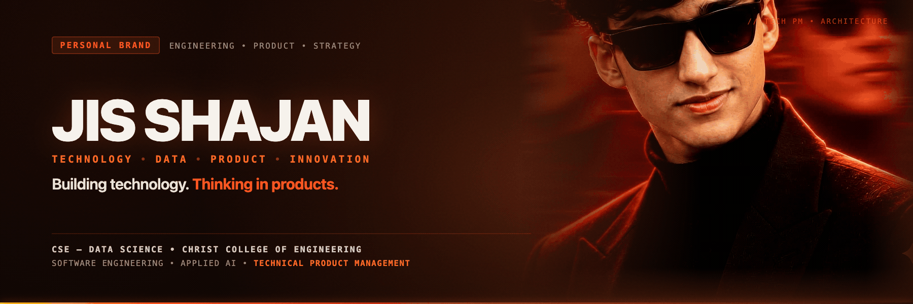
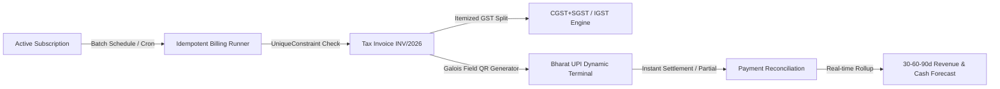
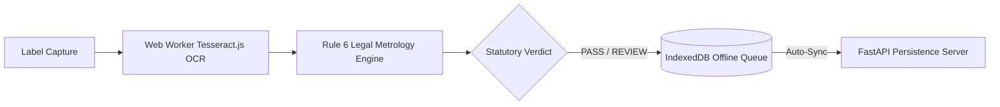

<div align="center">



<br />
<br />

[](https://jis-shajan-portfolio.vercel.app)
[](https://www.linkedin.com/in/jis-shajan)
[](mailto:jisshajan1@gmail.com)
[](https://github.com/jisssz)
<br />
[](https://leetcode.com/u/bMFExkNlUl/)

<p align="center">
  <strong>Computer Science & Engineering (Data Science) Undergraduate</strong> • <strong>Technical Product Management Aspirant</strong> • <strong>Systems Builder</strong><br />
  <em>Christ College of Engineering (APJ Abdul Kalam Technological University) • Kerala, India</em>
</p>

</div>

---

## ⚡ Executive Profile: Engineering Mindset + Product Thinking + Business Understanding

> *"Building technology. Thinking in products."*

I am a Computer Science & Engineering (Data Science) undergraduate developing toward **Technical Product Management (Tech PM)**, supported by hands-on full-stack engineering, applied machine learning, and project leadership.

I specialize in bridging the gap between business objectives, user workflows, and technical system architecture:
- **Product Strategy & Problem Scoping:** Deconstructing complex, fragmented operational pain points into prioritized product roadmaps and deterministic user journeys.
- **Engineering Execution & System Integrity:** Architecting resilient full-stack platforms with strict mathematical guarantees (e.g. idempotent billing engines, client-side offline OCR, relational star schemas).
- **Data-Driven Decision Making:** Leveraging analytical pipelines, telemetry modeling, and statistical forecasting to measure feature impact and eliminate commercial ambiguity.
- **Cross-Functional Collaboration:** Leading multi-disciplinary hackathon teams from initial problem framing through technical specification, implementation, QA, and executive stakeholder demo.

---

## 🏆 Featured Products & Systems

### 🥇 1. [SubSync — Intelligent Subscription & Revenue Operations Platform](https://github.com/jisssz/make_a_ton)
> **Role:** Team Leader, Technical Product Lead & Full-Stack Architect • **Hackathon:** Odoo × Make-A-Ton 9.0 Kochi Hackathon (2026)  
> **Product Value:** Eliminating SaaS revenue leakage and invoice disputes through automated billing operations and predictive cash forecasting.

- **The Problem:** Subscription-based SaaS companies face severe revenue leakage: manual invoicing errors, missed renewal dates, untracked overdue payments, and double-billing disputes caused by spreadsheet-driven billing operations.
- **Target User:** Finance operations leads, CFOs, and billing administrators managing high-volume recurring customer accounts.
- **Product Solution:** A unified, production-grade recurring revenue management platform managing the end-to-end customer-to-cash lifecycle: dynamic product/plan catalogs, quotations, automated batch billing, GST compliance, partial payment reconciliation, and 30-60-90 day forward-looking predictive cash forecasting.
- **Technical & Architectural Execution:**
  - **Zero Double-Billing Guarantee:** Database-level `UniqueConstraint(subscription, period_start)` preventing duplicate invoice generation across recurring cycles.
  - **Financial Precision:** Integer-paise database storage (100 paise = ₹1.00) eliminating floating-point rounding inaccuracies.
  - **Predictive Cash Forecasting:** Mathematically rigorous 30-60-90 day projection engine separating Contractual Expected Billings from Expected Cash Collections using historical collection efficiency factors.
  - **Instant Bharat UPI Dynamic QR:** Pure JavaScript Galois Field $GF(2^8)$ QR synthesizer (`qr.js`) generating standard NPCI vector deep links (`upi://pay?...`) with instant settlement writes to backend.
  - **Interactive Time-Travel Sandbox:** Temporal simulation engine executing batch billing runs up to +90 days into the future.
- **Verified Evidence:** **15 / 15 automated backend tests** passing (100%), **8 / 8 live E2E lifecycle stages** verified, 0 console errors.
- **Tech Stack:** `Python` • `Django REST Framework` • `React 18` • `Vite` • `PostgreSQL / SQLite` • `Tailwind CSS` • `Recharts`



---

### 🥈 2. [JAMEx-LMCC — Legal Metrology Compliance Checker](https://github.com/jisssz/JAMEx-LMCC)
> **Role:** Technical Product Architect & AI Lead • **Event:** AIBoomi Startup Weekend / SIH 2026  
> **Product Value:** Transforming slow, manual regulatory label audits into instant, client-side statutory screening verdicts with zero cloud privacy risks.

- **The Problem:** Enforcement officers and compliance inspectors spend hours manually inspecting tiny packaged commodity labels against Indian Legal Metrology regulations, battling reflective packaging glare, crinkled surfaces, and tiny fonts.
- **Target User:** Legal metrology field inspectors, consumer protection authorities, and FMCG packaging QA teams.
- **Product Solution:** An offline-first Progressive Web Application with client-side OCR and deterministic statutory rule evaluation, providing immediate **PASS** or **REVIEW** legal screening verdicts.
- **Technical & Architectural Execution:**
  - **100% Client-Side Privacy:** Web Workers execute multi-pass image binarization and Tesseract.js OCR locally in browser memory without sending private photos over external networks.
  - **Statutory Gazette Rule Engine:** Deterministic rule parser cross-referencing statutory Gazette amendments (G.S.R. 202(E), G.S.R. 779(E)) for MRP, Net Quantity, Manufacturer details, and Consumer Care contacts.
  - **Offline Sync:** Automatic IndexedDB local queue synchronization with FastAPI persistence server upon network reconnection.
- **Verified Evidence:** **198 frontend Vitest unit/integration tests**, **61 backend pytest tests**, production deployment live on Vercel.
- **Tech Stack:** `TypeScript` • `React` • `Vite` • `Tesseract.js` • `Web Workers` • `FastAPI` • `PWA` • `IndexedDB`
- 🌐 **Live Application:** [https://lmcc-web-ten.vercel.app](https://lmcc-web-ten.vercel.app)



---

### 🥉 3. [DailyVerse AI — Automated Visual Publishing & Syndication SaaS](https://github.com/jisssz/verse-automator)
> **Role:** Full-Stack & Automation Product Lead  
> **Product Value:** Automating 15+ hours weekly of manual visual asset creation, copywriting, and board syndication for digital commerce.

- **The Problem:** Skincare affiliate marketers spend hours manually designing vertical pins, writing SEO descriptions, and scheduling board posts across platforms.
- **Target User:** E-commerce brand operators, affiliate content creators, and growth marketing teams.
- **Product Solution:** End-to-end automated SaaS content engine transforming luxury skincare product URLs into publication-ready 9:16 vertical graphics, SEO botanical copy, and automated scheduled board syndications.
- **Technical & Architectural Execution:** Modern SSR/CSR architecture on TanStack Start (React 19) orchestrating decoupled n8n asynchronous webhook queues, OpenAI GPT-4o copy generation, Supabase RLS persistence, and Pinterest API v5 syndication.
- **Tech Stack:** `TypeScript` • `TanStack Start` • `React 19` • `Supabase (PostgreSQL)` • `OpenAI GPT-4o` • `n8n` • `Pinterest API v5`
- 🌐 **Live Platform:** [https://verse-automator.pages.dev](https://verse-automator.pages.dev)

---

### 4. [INSIGHT.arc — Retail Customer Intelligence & Decision-Support Warehouse](https://github.com/jisssz/SEP-JIS-SHAJAN)
> **Role:** Analytics & Data Product Lead  
> **Product Value:** Converting fragmented retail transactional logs into actionable customer retention and payment trajectory intelligence.

- **The Problem:** Retail organizations struggle to extract actionable operational insights and customer churn patterns from fragmented operational transactional tables.
- **Target User:** Retail operations executives, merchandising leads, and store managers.
- **Product Solution:** An end-to-end data analytics suite modeling ₹11,06,505 in sales volume across 320 retail transactions over 18 months, evaluating payment method dominance (UPI vs. Cards) and product category trajectories.
- **Technical & Architectural Execution:** Normalized Star Schema dimensional architecture linking Fact Orders to Customer, Employee, and Product dimensions, coupled with Pandas data cleaning and interactive Power BI DAX executive dashboards.
- **Tech Stack:** `Python` • `Pandas` • `Jupyter Notebook` • `Power BI Desktop (DAX)` • `Relational SQL`

---

### 5. [GreenPulse — Civic Problem Reporting & Municipal Enforcement Platform](https://github.com/jisssz/greenpulse)
> **Role:** Backend & Product Systems Lead  
> **Product Value:** Creating an auditable, transparent bridge between citizen environmental incident reports and municipal action dispatch.

- **The Problem:** Citizens lack a transparent, auditable channel to report environmental violations (illegal dumping, industrial discharge) and monitor municipal enforcement.
- **Target User:** Civic-minded citizens and municipal environmental protection officers.
- **Product Solution:** Full-stack civic platform featuring geo-tagged incident reporting, real-time status auditing, and administrative dispatch workflows.
- **Tech Stack:** `Java` • `Spring Boot` • `PostgreSQL` • `REST API` • `React` • `Tailwind CSS`
- 🌐 **Live Demo:** [https://frontend-nine-woad-g8xvq6ys3s.vercel.app](https://frontend-nine-woad-g8xvq6ys3s.vercel.app)

---

### 6. [PayProof — Autonomous B2B Receivables Copilot](https://github.com/jisssz/payproof-receivables-copilot)
> **Role:** Fintech Product & Full-Stack Lead  
> **Product Value:** Protecting MSME cash flow through deterministic invoice aging and automated dispute communications.

- **The Problem:** B2B MSMEs suffer crippling cash flow delays due to disputed invoices, untracked delivery acknowledgments, and lack of formal statutory demand notices.
- **Target User:** Small business owners and receivables accounting clerks.
- **Product Solution:** Receivables copilot enforcing deterministic aging calculations (Current, 1–30d, 31–60d, 60d+), MSME Samadhaan compounding interest calculations, and AI dispute resolution draft letters.
- **Tech Stack:** `FastAPI (Python 3.11)` • `React` • `Pydantic` • `Render` • `Vercel` • `Pytest`

---

## 🛠️ Core Competencies: Product & Technology Matrix

| Discipline | Core Competencies & Tooling |
|---|---|
| **Technical Product Management** | Product Roadmapping, Requirement Scoping (PRDs), User Journey Mapping, Feature Prioritization, Trade-off Analysis, Cross-Functional Team Leadership |
| **Full-Stack Engineering** | Python (Django REST Framework, FastAPI), TypeScript, React 18/19, Vite, TanStack Start, Tailwind CSS, Java Spring Boot, REST API Architecture |
| **Data Science & Analytics** | Exploratory Data Analysis (EDA), Pandas, NumPy, Scikit-Learn, Power BI (DAX), Relational Star Schema Design, Predictive Modeling |
| **Databases & Systems** | PostgreSQL, Supabase (RLS), SQLite, Redis, IndexedDB, Idempotency & Database Integrity Constraints |
| **Product Operations & Automation** | Git / GitHub Actions, Docker, Linux, n8n Automation, Webhook Pipelines, Vercel, Cloudflare Pages |

---

## 🎓 Academic Background & Leadership

- **🎓 Degree:** B.Tech in Computer Science & Engineering (Data Science)  
  *Christ College of Engineering, Irinjalakuda (APJ Abdul Kalam Technological University)* • 3rd Year
- **🏆 Odoo × Make-A-Ton 9.0 Kochi Hackathon (2026):** Team Leader & Technical Product Lead for *SubSync* — managed sprint planning, architecture, and live E2E delivery.
- **🏆 AIBoomi Startup Weekend Kochi:** Team Lead & Technical Architect for *JAMH X / LMCC* — offline-first statutory compliance screening product.
- **🏆 Smart India Hackathon (SIH 2026):** Lead developer for client-side regulatory automation and document verification solutions.
- **💼 Industry Experience:** Project Management & Automation Intern — client coordination, Zoho workflow design, and operational process syndication.

---

<div align="center">

### 📫 Connect & Collaborate

[](https://jis-shajan-portfolio.vercel.app)
[](https://www.linkedin.com/in/jis-shajan)
[](mailto:jisshajan1@gmail.com)
[](https://github.com/jisssz)
[](https://leetcode.com/u/bMFExkNlUl/)

<br />

```
"Building resilient architectures that bridge engineering depth, user workflows, and business outcomes."
```

</div>
