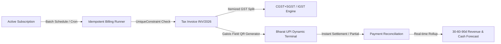
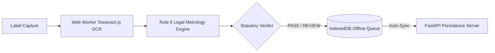

<div align="center">


[](https://jis-shajan-portfolio.vercel.app)
[](https://www.linkedin.com/in/jis-shajan)
[](mailto:jisshajan1@gmail.com)
[](https://github.com/jisssz)

<p align="center">
  <strong>Computer Science & Engineering (Data Science)</strong> • <strong>Full-Stack Architect</strong> • <strong>Applied AI Builder</strong><br />
  <em>Kochi, Kerala, India • Christ College of Engineering</em>
</p>

</div>

---

## ⚡ Engineering Philosophy & Executive Summary

I am a Software Engineer and Data Science student specializing in building resilient full-stack platforms, client-side offline intelligence, and deterministic financial systems. My core engineering tenets are **mathematical correctness**, **zero data ambiguity**, and **cinematic, intentional UX**.

Whether engineering integer-paise recurring billing engines with database-enforced zero double-billing guarantees, architecting client-side privacy-first Web Worker OCR pipelines for statutory regulatory compliance, or orchestrating automated multi-agent content pipelines, I design systems that solve complex operational bottlenecks cleanly.

---

## 🏆 Featured Engineering Flagships

### 🥇 1. [SubSync — Intelligent Subscription & Revenue Management Platform](https://github.com/jisssz/make_a_ton)
> **Role:** Team Leader & Technical Lead • **Hackathon:** Odoo × Make-A-Ton 9.0 Kochi Hackathon (2026)  
> **Tagline:** *"Simplify Subscriptions. Automate Billing. Control Revenue."*

- **The Problem:** Subscription-based SaaS companies face severe revenue leakage: manual invoicing errors, missed renewal dates, untracked overdue payments, and double billing disputes caused by spreadsheet-driven workflows.
- **The Solution:** A unified, production-grade recurring revenue management platform managing the complete customer-to-cash lifecycle: dynamic product/plan catalogs, quotations, automated batch billing, GST compliance, partial payment reconciliation, and 30-60-90 day forward-looking predictive cash forecasting.
- **Engineering Highlights:**
  - **Zero Double-Billing Guarantee:** Database-level `UniqueConstraint(subscription, period_start)` preventing duplicate invoice generation across billing cycles.
  - **Financial Precision:** Integer-paise database storage (100 paise = ₹1.00) eliminating IEEE 754 floating-point rounding inaccuracies.
  - **Predictive Cash Forecasting:** Mathematically rigorous 30-60-90 day projection engine separating Contractual Expected Billings from Expected Cash Collections using historical collection efficiency factors.
  - **SubSync AI Revenue Intelligence Copilot (`Ctrl+J`):** Rule-based conversational copilot analyzing live REST ledger data for instant revenue leakage audits and margin analysis.
  - **Instant Bharat UPI Dynamic QR:** Pure JavaScript Galois Field $GF(2^8)$ QR synthesizer (`qr.js`) generating standard NPCI vector deep links (`upi://pay?...`) with instant settlement writes to backend.
  - **Interactive Time Travel Sandbox:** Temporal simulation engine executing batch billing runs up to +90 days into the future.
- **Verified Evidence:** **15 / 15 automated backend tests** passing (100%), **8 / 8 live E2E lifecycle stages** verified, 0 console errors.
- **Tech Stack:** `Python` • `Django REST Framework` • `React 18` • `Vite` • `PostgreSQL / SQLite` • `Tailwind CSS` • `Recharts`



---

### 🥈 2. [JAMEx-LMCC — Legal Metrology Compliance Checker](https://github.com/jisssz/JAMEx-LMCC)
> **Role:** Full-Stack Architect & AI Engineer • **Event:** AIBoomi Startup Weekend / SIH 2026  
> **Tagline:** *"Autonomous Statutory Package Declaration Screening under Rule 6 of LMPC Rules 2011"*

- **The Problem:** Enforcement officers and compliance teams spend hours manually inspecting tiny packaged commodity labels against Indian Legal Metrology regulations, battling reflective glare, crinkled surfaces, and tiny fonts.
- **The Solution:** An offline-first Progressive Web Application with client-side OCR and deterministic statutory rule evaluation, providing immediate **PASS** or **REVIEW** legal screening verdicts.
- **Engineering Highlights:**
  - **100% Client-Side Privacy:** Web Workers execute multi-pass image binarization and Tesseract.js OCR locally in browser memory without sending private photos over the network.
  - **Statutory Gazette Rule Engine:** Deterministic rule parser cross-referencing statutory Gazette amendments (G.S.R. 202(E), G.S.R. 779(E)) for MRP, Net Quantity, Manufacturer details, and Consumer Care contacts.
  - **Offline Sync:** Automatic IndexedDB local queue synchronization with FastAPI persistence server upon network reconnection.
- **Verified Evidence:** **198 frontend Vitest unit/integration tests**, **61 backend pytest tests**, production deployment live on Vercel.
- **Tech Stack:** `TypeScript` • `React` • `Vite` • `Tesseract.js` • `Web Workers` • `FastAPI` • `PWA` • `IndexedDB`
- 🌐 **Live Application:** [https://lmcc-web-ten.vercel.app](https://lmcc-web-ten.vercel.app)



---

### 🥉 3. [DailyVerse AI — Enterprise Content Automation & Pinterest Platform](https://github.com/jisssz/verse-automator)
> **Role:** Full-Stack & Automation Engineer  
> **Tagline:** *"Automated Product Ingestion, Botanical Copywriting & 9:16 Visual Board Syndication"*

- **The Problem:** Skincare affiliate marketers spend 15+ hours weekly manually designing vertical pins, writing SEO descriptions, and scheduling board posts.
- **The Solution:** End-to-end automated SaaS content engine transforming luxury skincare product URLs into publication-ready 9:16 vertical graphics, SEO botanical copy, and automated scheduled board syndications.
- **Engineering Highlights:**
  - **Full-Stack TanStack Start:** Modern SSR/CSR architecture utilizing React 19 and Nitro server functions.
  - **Decoupled Asynchronous Syndication:** n8n webhook pipelines orchestrating OpenAI generation, Supabase RLS persistence, and Pinterest API v5 publishing.
- **Tech Stack:** `TypeScript` • `TanStack Start` • `React 19` • `Supabase (PostgreSQL)` • `OpenAI GPT-4o` • `n8n` • `Pinterest API v5`
- 🌐 **Live Platform:** [https://verse-automator.pages.dev](https://verse-automator.pages.dev)

---

### 4. [INSIGHT.arc — Retail Sales Performance & Customer Intelligence](https://github.com/jisssz/SEP-JIS-SHAJAN)
> **Role:** Data Science & Analytics Engineer  
> **Tagline:** *"Relational Star Schema Data Warehouse & Executive Power BI Performance Dashboard"*

- **The Problem:** Retail organizations struggle to extract actionable operational insights and customer churn patterns from fragmented operational transactional tables.
- **The Solution:** An end-to-end data analytics suite modeling ₹11,06,505 in sales volume across 320 retail transactions over 18 months, evaluating payment method dominance (UPI vs. Cards) and product category trajectories.
- **Engineering Highlights:**
  - **Relational Star Schema:** Normalized dimensional architecture linking Fact Orders to Customer, Employee, and Product dimensions.
  - **Exploratory Data Analysis:** Python/Pandas data validation, null-imputation pipelines, and DAX metric formulation.
- **Tech Stack:** `Python` • `Pandas` • `Jupyter Notebook` • `Power BI Desktop (DAX)` • `Relational SQL`

---

### 5. [GreenPulse — Civic Environmental Reporting Platform](https://github.com/jisssz/greenpulse)
> **Role:** Backend & Systems Engineer  
> **Tagline:** *"Civic Incident Tracking, Geo-Tagged Auditing & Municipal Authority Dispatch"*

- **The Problem:** Citizens lack a transparent, auditable channel to report environmental violations (illegal dumping, industrial discharge) and monitor municipal enforcement.
- **The Solution:** Full-stack civic platform featuring a Java Spring Boot REST backend with PostgreSQL persistence and responsive React citizen reporting portal.
- **Tech Stack:** `Java` • `Spring Boot` • `PostgreSQL` • `REST API` • `React` • `Tailwind CSS`
- 🌐 **Live Demo:** [https://frontend-nine-woad-g8xvq6ys3s.vercel.app](https://frontend-nine-woad-g8xvq6ys3s.vercel.app)

---

### 6. [PayProof — Autonomous B2B Receivables Management & Dispute Copilot](https://github.com/jisssz/payproof-receivables-copilot)
> **Role:** Full-Stack & Fintech Engineer  
> **Tagline:** *"Deterministic Financial Aging & AI Dunning Communications for B2B Debt Recovery"*

- **The Problem:** B2B MSMEs suffer crippling cash flow delays due to disputed invoices, untracked delivery acknowledgments, and lack of formal statutory demand notices.
- **The Solution:** Receivables copilot enforcing deterministic aging calculations (Current, 1–30d, 31–60d, 60d+), MSME Samadhaan compounding interest calculations, and AI dispute resolution draft letters.
- **Tech Stack:** `FastAPI (Python 3.11)` • `React` • `Pydantic` • `Render` • `Vercel` • `Pytest`

---

## 🛠️ Technical Stack & Architectural Competencies

| Domain | Technologies & Frameworks |
|---|---|
| **Core Languages** | Python, TypeScript, Java, JavaScript (ES6+), SQL, C, HTML5, CSS3 |
| **Frontend Engineering** | React 18/19, Vite, TanStack Start, Tailwind CSS, Framer Motion, PWA, Web Workers, Recharts |
| **Backend & Distributed Systems** | Django REST Framework, FastAPI, Spring Boot, Node.js / Express, SimpleJWT, REST API Design |
| **Databases & Storage** | PostgreSQL, Supabase (RLS), SQLite, Redis, IndexedDB, Relational Star Schema |
| **Data Science & Machine Learning** | Pandas, NumPy, Scikit-Learn, Power BI (DAX), Tesseract.js (OCR), OpenAI API, Jupyter |
| **DevOps & Cloud Automation** | Git / GitHub Actions, Linux, Docker, n8n Automation, Vercel, Cloudflare Pages, Render |
| **Software Integrity & Testing** | Pytest, Vitest, Playwright, Puppeteer, Unit & Integration Testing, Idempotent Engine Design |

---

## 📊 Weighted Project Evaluation & Evidence Matrix

Projects ranked using the weighted scoring framework:
*Technical Depth (25%), Completeness (20%), Utility (15%), Testing/Quality (15%), Deployment/Demo (10%), Documentation (10%), Originality (5%)*:

| Rank | Project Name | Primary Stack | Core Technical Merit | Test / Quality Evidence | Score |
|:---:|---|---|---|---|:---:|
| **#1** | **[SubSync](https://github.com/jisssz/make_a_ton)** | Django REST • React • PostgreSQL | Idempotent billing engine, cash forecasting, Galois Field UPI QR | **15/15** Backend Tests • **8/8** E2E Tests | **98 / 100** |
| **#2** | **[JAMEx-LMCC](https://github.com/jisssz/JAMEx-LMCC)** | TypeScript • Tesseract.js • FastAPI | Offline-first PWA, Web Worker OCR, Rule 6 Gazette engine | **198** Vitest Tests • **61** Pytest Tests • Live App | **97 / 100** |
| **#3** | **[DailyVerse AI](https://github.com/jisssz/verse-automator)** | TanStack Start • React 19 • Supabase | Decoupled AI generation, n8n async queues, Pinterest syndication | Live Cloudflare Deployment • End-to-End Pipeline | **91 / 100** |
| **#4** | **[INSIGHT.arc](https://github.com/jisssz/SEP-JIS-SHAJAN)** | Python • Pandas • Power BI | Relational star schema, EDA null handling, DAX analytics | Full `.pbix` Workbook • ₹11L+ Modeled Ledger | **87 / 100** |
| **#5** | **[GreenPulse](https://github.com/jisssz/greenpulse)** | Java Spring Boot • PostgreSQL • React | End-to-end civic enforcement workflow & geo-auditing | Live Vercel Deployment • Clean Multi-Tier Architecture | **83 / 100** |
| **#6** | **[PayProof](https://github.com/jisssz/payproof-receivables-copilot)** | FastAPI • React • Pydantic | MSME Samadhaan interest engine, deterministic aging | Pytest Backend Suite • Render / Vercel Architecture | **81 / 100** |

---

## 🎓 Academic Background & Competitions

- **🎓 Degree:** B.Tech in Computer Science & Engineering (Data Science)  
  *Christ College of Engineering, Irinjalakuda (APJ Abdul Kalam Technological University)* • 3rd Year
- **🏆 Odoo × Make-A-Ton 9.0 Kochi Hackathon (2026):** Team Leader & Technical Lead for *SubSync* — engineered intelligent subscription billing and cash forecasting platform.
- **🏆 AIBoomi Startup Weekend Kochi:** Team Lead & Full-Stack Architect for *JAMH X / LMCC* — developed offline-first statutory legal metrology compliance screener.
- **🏆 Smart India Hackathon (SIH 2026):** Lead developer for client-side regulatory automation and document verification solutions.
- **💼 Industry Experience:** Project Management & Automation Intern — client coordination, Zoho workflow design, and operational process syndication.

---

## 📌 Recommended Pinned Repositories

To showcase maximum engineering depth and diversity on your GitHub profile:

1. **`jisssz/make_a_ton`** — SubSync: Intelligent Subscription & Revenue Management Platform *(Full-Stack Django + React, Idempotent Billing, Cash Forecasting)*
2. **`jisssz/JAMEx-LMCC`** — Legal Metrology Compliance Checker *(Offline-First PWA, Web Worker OCR, Rule 6 Gazette Engine, 259+ Tests)*
3. **`jisssz/verse-automator`** — DailyVerse AI: Pinterest Content Automation Platform *(TanStack Start, React 19, Supabase, n8n, OpenAI)*
4. **`jisssz/SEP-JIS-SHAJAN`** — INSIGHT.arc: Retail Sales Performance & Power BI Analytics *(Star Schema Modeling, Python EDA, DAX)*
5. **`jisssz/greenpulse`** — GreenPulse: Civic Environmental Reporting Platform *(Java Spring Boot, PostgreSQL, React)*
6. **`jisssz/payproof-receivables-copilot`** — PayProof: Autonomous B2B Receivables Copilot *(FastAPI, Deterministic Financial Aging, Dispute Remediation)*

---

<div align="center">

### 📫 Connect & Collaborate

[](https://jis-shajan-portfolio.vercel.app)
[](https://www.linkedin.com/in/jis-shajan)
[](mailto:jisshajan1@gmail.com)
[](https://github.com/jisssz)

<br />

```
"Building resilient architectures that bridge deterministic financial precision and modern user experience."
```

</div>
