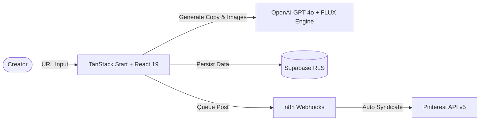
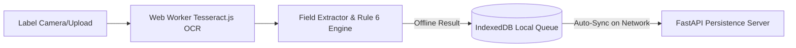
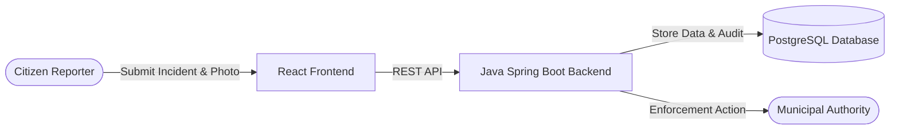

# Jis Shajan

**Computer Science & Data Science Student** • **Product & Software Builder**  
I build AI-powered products, full-stack applications, and data automation systems focused on real-world utility, robust software architecture, and user experience.

---

## ⚡ What I Build

- **AI & Automation Engines**: Intelligent workflow platforms, API syndication pipelines, and LLM-driven content generators.
- **Full-Stack Applications**: Scalable Web applications built with Spring Boot, Node.js/Express, React, and Supabase.
- **Data Analytics & BI**: Exploratory data analysis, customer analytics, and executive Power BI dashboards.
- **Offline-First PWAs**: Client-side OCR rule engines powered by Tesseract.js Web Workers and IndexedDB.
- **Developer Utilities**: API gateways, mock platforms, and hackathon prototypes built for speed and reliability.

---

## 🚀 Featured Projects

### 🥇 1. [DailyVerse AI — Pinterest Content & Automation Platform](https://github.com/jisssz/verse-automator)
> **Problem:** Beauty affiliate marketers spend 15+ hours weekly manually designing 9:16 pins and writing SEO copy.  
> **Solution:** Enterprise automation platform generating studio-grade vertical visuals, botanical copy, and automated board syndication.  
> **Engineering Highlight:** Decoupled multi-service AI image rendering & publishing using asynchronous n8n queues and Supabase Realtime.  
> **Tech Stack:** `TypeScript` • `TanStack Start` • `React 19` • `Supabase` • `OpenAI` • `n8n` • `Pinterest API v5`  
> 🌐 **Live Platform:** [https://verse-automator.pages.dev](https://verse-automator.pages.dev)

---

### 🥈 2. [Legal Metrology Compliance Checker (SIH 2026)](https://github.com/jisssz/JAMH-X4)
> **Problem:** Packaged commodity label verification requires manual regulatory audits under Legal Metrology Rules, 2011.  
> **Solution:** Offline-first Progressive Web Application with client-side Tesseract.js OCR in Web Workers for instant label screening.  
> **Engineering Highlight:** 100% client-side privacy preservation — Web Workers execute 2-pass image binarization & Rule 6 evaluation locally.  
> **Tech Stack:** `TypeScript` • `React` • `Vite` • `Tesseract.js` • `Web Workers` • `IndexedDB` • `PWA`

---

### 🥉 3. [GreenPulse — Civic Environmental Reporting Platform](https://github.com/jisssz/greenpulse)
> **Problem:** Citizens lack a transparent, real-time channel to report environmental violations and track enforcement.  
> **Solution:** Full-stack civic engagement platform with RESTful Spring Boot backend and responsive React reporting interface.  
> **Engineering Highlight:** End-to-end evidence verification workflow connecting citizen reports with operational authority enforcement.  
> **Tech Stack:** `Java` • `Spring Boot` • `REST API` • `React` • `PostgreSQL` • `TailwindCSS`  
> 🌐 **Live Demo:** [https://frontend-nine-woad-g8xvq6ys3s.vercel.app](https://frontend-nine-woad-g8xvq6ys3s.vercel.app)

---

### 4. [Personal Developer Portfolio](https://github.com/jisssz/jisssz.github.io)
> **Problem:** Static developer resumes fail to communicate interactive product thinking and visual frontend craftsmanship.  
> **Solution:** High-performance developer portfolio featuring a 300-frame scroll-driven visual canvas and project storytelling.  
> **Tech Stack:** `TypeScript` • `React` • `Vite` • `TailwindCSS` • `Framer Motion`  
> 🌐 **Live Site:** [https://jis-shajan-portfolio.vercel.app](https://jis-shajan-portfolio.vercel.app)

---

### 5. [Hell Yeah API Gateway](https://github.com/jisssz/hell-yeah-useless-api)
> **Problem:** Hackathon developer teams need rapid API integration sandboxes and creative REST gateways.  
> **Solution:** Modular Node.js REST API gateway engineered with nanosecond-precision telemetry, rate limiting, and Malayalam pop-culture aesthetics.  
> **Tech Stack:** `TypeScript` • `Node.js` • `Express` • `REST API`

---

### 6. [Data Analytics & Business Intelligence](https://github.com/jisssz/SEP-JIS-SHAJAN)
> **Problem:** Retail businesses struggle to extract actionable insights from multi-table operational databases.  
> **Solution:** End-to-end data analytics suite featuring retail star-schema modeling, revenue trend analysis, and Power BI dashboards.  
> **Tech Stack:** `Python` • `Pandas` • `Jupyter` • `Power BI` • `SQL`

---

## 🛠️ Technical Stack & Expertise

| Category | Technologies |
| :--- | :--- |
| **Languages** | Python, Java, JavaScript (ES6+), TypeScript, SQL, C, HTML5, CSS3 |
| **Frontend** | React 19, Vite, TanStack Start, TailwindCSS, Framer Motion, PWA |
| **Backend & APIs** | Node.js, Express, Spring Boot, REST APIs, Supabase, SQLite, PostgreSQL |
| **Data & AI** | TensorFlow, NumPy, Pandas, Power BI, Tesseract.js, OpenAI API |
| **Cloud & Tools** | Git/GitHub, n8n Automation, Postman, Vercel, Cloudflare Pages, Linux |

---

## 🎯 Current Focus & Active Learning

- 🔬 **System Design & Distributed Workflows:** Deepening knowledge of microservice resilience, message queues, and event-driven architectures.
- 🤖 **LLM Agents & Tool Use:** Building autonomous AI agents utilizing tool calling, structured outputs, and workflow orchestration.
- 📊 **Advanced Analytics:** Exploring predictive machine learning models with Scikit-Learn and production model deployment.

---

## 📈 Activity & Academic Background

- 🎓 **Education:** B.Tech Computer Science & Engineering (Data Science), Christ College of Engineering, Irinjalakuda (3rd Year).
- 🏆 **Hackathons & Competitions:** Active team lead and developer in Smart India Hackathon (SIH 2026), college technical hackathons, and ideathons.
- 💼 **Industry Experience:** Internship experience in Project Management, client project coordination, Zoho ecosystem, and operational automation.

---

## 📫 Connect & Collaborate

- **Portfolio:** [jis-shajan-portfolio.vercel.app](https://jis-shajan-portfolio.vercel.app)
- **LinkedIn:** [linkedin.com/in/jis-shajan](https://www.linkedin.com/in/jis-shajan)
- **Email:** [jisshajan1@gmail.com](mailto:jisshajan1@gmail.com)
